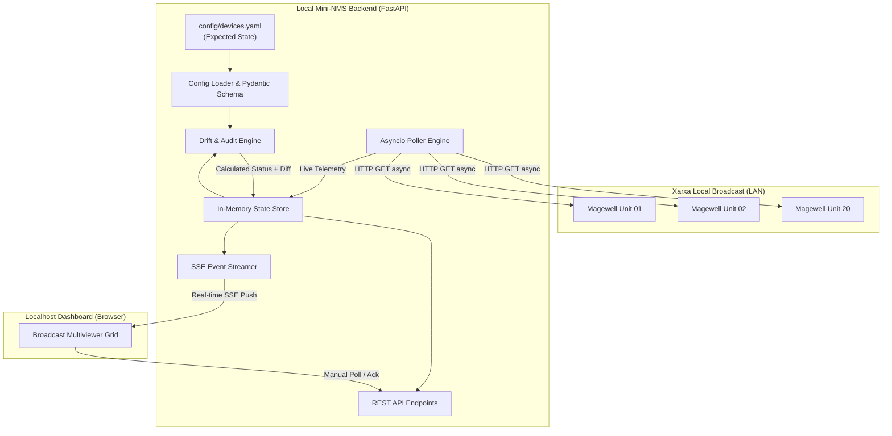

# Requirements

### Overview & Goals
Proporcionar una solució de monitoratge lleugera, autònoma i d'alta eficiència (Mini-NMS) que s'executi en local per supervisar contínuament una flota d'unes 20 unitats Magewell Pro Convert (codificadors/descodificadors NDI/HDMI/SDI).

L'objectiu principal és maximitzar la disponibilitat operativa i la visibilitat de la infraestructura audiovisual sense dependre de llicències de pagament (com Magewell Control Hub), permetent:
1. **Detecció immediata d'incidències:** Saber a l'instant si un equip està `ONLINE`/`OFFLINE`.
2. **Supervisió de senyal:** Verificar si hi ha senyal d'entrada de vídeo HDMI/SDI actiu (*signal lock*), resolució i freqüència de quadre.
3. **Auditoria de configuració (*Expected State*):** Alertar visualment si la configuració en viu d'un equip o el seu format de vídeo divergeix del que s'ha definit prèviament al fitxer de configuració YAML.

---

### Scope
#### In Scope
- **Motor de polling asíncron local:** Sondeig concurrent periòdic de les 20 unitats Magewell mitjançant les seves APIs HTTP (`get-summary-info`, `get-signal-info`, `get-device-info`).
- **Fitxer de configuració declaratiu (`devices.yaml`):** Definició d'IPs, noms de dispositiu, rols, credencials i estat esperat de senyal/vídeo.
- **Detecció de desviacions (*Drift Detection*):** Comparació contínua entre l'estat real i l'esperat (p. ex., resolució esperada 1080p50 vs 720p o sense senyal).
- **Dashboard Web NMS en temps real:** Interfície web local basada en FastAPI + Server-Sent Events (SSE) amb graella de monitoratge multivisió (estat, senyal, temperatura, bitrate, avisos).
- **Gestió de fallades i resiliència de xarxa:** Timeouts curts (2 segons), aïllament d'errors per unitat i reconnexió automàtica.

#### Out of Scope
- Modificació o reconfiguració remota massiva d'equips (l'enfocament prioritari és la telemetria, observabilitat i prevenció d'errors).
- Gravació de fluxos de vídeo o descodificació de vídeo en viu al navegador (per mantenir un consum de CPU/RAM mínim).
- Infraestructura complexa de bases de dades distribuïdes (es prioritza emmagatzematge en memòria + registre d'esdeveniments local).

---

### User Stories
- **Com a operador de realització/enginyer de continuïtat broadcast:** Vull veure en una sola pantalla l'estat de les 20 unitats Magewell per detectar en menys d'un segon si un conversor s'ha desconnectat o ha perdut el senyal d'entrada HDMI abans d'iniciar la producció.
- **Com a responsable tècnic d'instal·lació AV:** Vull que el sistema compari la configuració física i de flux amb un fitxer `devices.yaml` de referència per detectar immediatament canvis accidentals de resolució o format de vídeo fets per usuaris locals als equips.
- **Com a administrador de sistemes:** Vull executar una aplicació lleugera a `localhost` que consumeixi recursos mínims (<50 MB RAM, <2% CPU) i no requereixi llicències comercials ni instal·lacions complexes.

---

### Functional Requirements
- **FR-1: Sondeig asíncron paral·lel:** El sistema ha d'inspeccionar les 20 unitats cada *N* segons (configurable, per defecte 3s) sense bloquejos seqüencials.
- **FR-2: Ingesta de telemetria Magewell:** Ha d'obtenir i consolidar dades clau de les APIs de Magewell:
  - Connectivitat HTTP / Ping response.
  - Estat del senyal d'entrada (`signal-locked`, `width`, `height`, `frame-rate`, `color-format`).
  - Estat del dispositiu (`temperature`, `cpu-usage`, `memory-usage`, `firmware-version`).
  - Estat de streaming / NDI (nom del flux, estat de connexió).
- **FR-3: Detecció de desviacions (Drift Engine):** Compara cada paràmetre real amb el definit a `devices.yaml` i genera una bandera d'estat:
  - `OK` (Senyal bloquejat i paràmetres idèntics a l'esperat).
  - `DRIFT / WARNING` (Dispositiu online, però resolució, framerate o nom diferent de l'esperat).
  - `NO SIGNAL` (Dispositiu online, però sense entrada de vídeo HDMI/SDI connectada o bloquejada).
  - `OFFLINE` (Unitat inaccessible a la xarxa).
- **FR-4: Actualització en viu per Server-Sent Events (SSE):** El dashboard ha de rebre les actualitzacions sense recarregar la pàgina ni fer peticions cícliques innecessàries des del client.
- **FR-5: Filtres operatius i mode nocturn:** El panell web ha de permetre filtrar ràpidament per "Només alertes / fallades", "Només per ubicació / rol", i oferir un tema fosc orientat a sales de control broadcast.

---

### Non-Functional Requirements
- **Eficiència de recursos:** Ús insignificant de CPU (<2% en un processador estàndard) i consum de memòria inferior a 60 MB.
- **Protecció de la xarxa i dels dispositius:** Ús de connexions reutilitzables (`keep-alive`) mitjançant `httpx.AsyncClient` amb un màxim de 5 peticions concurrents per evitar saturar els servidors web encastats dels Magewell.
- **Latència d'actualització:** Notificació visual de caiguda d'equip o pèrdua de senyal en menys de 3 segons des que es produeix l'esdeveniment físic.
- **Portabilitat:** Execució senzilla a Windows / Linux / macOS amb Python 3.10+ mitjançant un sol comandament (`uvicorn app.main:app`).

# Technical Design

### Current Implementation
El directori del projecte es troba buit. Els dispositius Magewell Pro Convert disposen d'un servidor HTTP integrat que exposa una API REST basada en JSON amb endpoints com:
- `/apis/get-summary-info`: Estat general del dispositiu, xarxa i telemetria bàsica.
- `/apis/get-signal-info`: Dades de l'entrada de vídeo (presència de senyal, resolució d'entrada, taxa de mostreig, espai de color).
- `/apis/get-device-info`: Model, número de sèrie, versió de microprogramari.

---

### Key Decisions
1. **Stack Tecnològic (Python + FastAPI + Uvicorn):**
   - *Decisió:* Utilitzar FastAPI amb `asyncio` i `httpx` per al backend, acompanyat d'un frontend integrat en HTML5/Tailwind/Alpine.js servit directament per FastAPI.
   - *Justificació:* Maximitza la utilitat reduint la complexitat operacional: proporciona una solució amb zero passos de compilació de frontend (`node_modules`), consum de recursos mínim i suport natiu excel·lent per a concurrència asíncrona i SSE.

2. **Mecanisme de comunicació en temps real (Server-Sent Events - SSE):**
   - *Decisió:* Utilitzar SSE (`EventSource`) per transmetre els estats des del backend al navegador en lloc de WebSocket bidireccional o polling HTTP des del navegador.
   - *Justificació:* La comunicació és unidireccional (telemetria cap al dashboard). SSE és més simple, reconnecta automàticament de forma nativa i té una sobrecàrrega de xarxa inferior.

3. **Emmagatzematge d'estat en memòria amb instantània de seguretat:**
   - *Decisió:* Mantenir l'estat viu dels 20 dispositius en un diccionari thread-safe en memòria, actualitzat pel bucle de polling.
   - *Justificació:* L'accés és instantani (O(1)), no genera escriptures constants a disc ni desgast de memòria en servidors de monitoratge, i el fitxer `devices.yaml` actua com a única font de veritat immutable.

4. **Motor d'auditoria declaratiu (*Expected State*):**
   - *Decisió:* Validar cada mostra recollida contra l'esquema definit a `devices.yaml`.
   - *Justificació:* Detecta de forma immediata errors humans o desconfiguracions accidentals (p. ex., càmera canviada a 1080p59.94 quan el sistema de continuïtat treballa a 1080p50).

---

### Architecture Diagram


---

### Data Models / Contracts

#### 1. Format del fitxer `devices.yaml`
```yaml
polling:
  interval_seconds: 3
  timeout_seconds: 2
  concurrency_limit: 5

devices:
  - id: "mw-cam-01"
    name: "Càmera Plató 1"
    ip: "192.168.1.101"
    model: "Pro Convert HDMI Plus"
    auth:
      username: "admin"
      password: "password123"
    expected:
      signal_locked: true
      width: 1920
      height: 1080
      frame_rate: 50.0
      max_temperature_c: 65.0
      ndi_name: "PLATO1-CAM1"

  - id: "mw-dec-01"
    name: "Descodificador Pantalla LED"
    ip: "192.168.1.120"
    model: "Pro Convert NDI to HDMI"
    auth:
      username: "admin"
      password: "password123"
    expected:
      signal_locked: true
      width: 1920
      height: 1080
      frame_rate: 50.0
      max_temperature_c: 65.0
```

#### 2. Model d'Estat del Dispositiu (`DeviceLiveStatus`)
```python
from pydantic import BaseModel
from typing import Optional, List
from enum import Enum

class HealthStatus(str, Enum):
    OK = "OK"
    WARNING = "WARNING"
    NO_SIGNAL = "NO_SIGNAL"
    OFFLINE = "OFFLINE"

class SignalInfo(BaseModel):
    locked: bool = False
    width: Optional[int] = None
    height: Optional[int] = None
    frame_rate: Optional[float] = None
    color_format: Optional[str] = None

class DeviceLiveStatus(BaseModel):
    id: str
    name: str
    ip: str
    status: HealthStatus
    is_online: bool
    response_time_ms: float
    temperature_c: Optional[float] = None
    signal: SignalInfo
    drifts: List[str] = []
    last_seen: str
```

---

### File Structure
```text
magewell/
├── config/
│   └── devices.yaml            # Configuració dels 20 equips i estat esperat
├── app/
│   ├── __init__.py
│   ├── main.py                 # Instància FastAPI i cicle de vida (lifespan)
│   ├── config.py               # Carregador i validador de devices.yaml
│   ├── models.py               # Models Pydantic de telemetria i estat
│   ├── magewell_client.py      # Client HTTP asíncron amb gestió d'APIs Magewell
│   ├── poller.py               # Motor de polling paral·lel concurrent
│   ├── drift_detector.py       # Algorisme de comparació (Expected vs Actual)
│   ├── state.py                # Magatzem d'estat centralitzat en memòria
│   └── routes/
│       ├── __init__.py
│       ├── api.py              # Endpoints REST (/api/devices, /api/reload)
│       └── events.py           # Canal SSE (/api/events)
├── templates/
│   └── index.html              # Dashboard multivisió (HTML5 + Jinja2)
├── static/
│   ├── css/
│   │   └── app.css             # Estils personalitzats NMS (tema fosc, badges)
│   └── js/
│       └── app.js              # Receptor SSE i gestió de l'arbre DOM reactiu
├── tests/
│   ├── __init__.py
│   ├── test_drift_detector.py  # Proves unitàries del motor de discrepàncies
│   ├── test_client.py          # Proves simulades de l'API Magewell
│   └── test_api.py             # Proves dels endpoints FastAPI
├── requirements.txt            # Dependències Python
└── README.md                   # Documentació d'instal·lació i ús
```

---

### Risks & Mitigations
- **Risc:** Saturació del processador encastat dels dispositius Magewell si es fan massa peticions per segon.
  - *Mitigació:* Control de concurrència mitjançant `asyncio.Semaphore(5)`, ús de sessions HTTP persistents amb *Keep-Alive* i un interval de polling prudent (3 a 5 segons per cicle complet).
- **Risc:** Dispositius apagats que provoquin bloquejos o increments de temps de cicle.
  - *Mitigació:* Timeout estricte de 2 segons per petició HTTP; quan un equip falla, es marca com a `OFFLINE` de forma independent sense retardar el sondeig dels altres 19 dispositius.
- **Risc:** Credencials o firmwares diferents entre unitats.
  - *Mitigació:* Configuració individualitzada de credencials a `devices.yaml` i tractament tolerant a errors amb valors per defecte si un camp d'API no està disponible en un firmware concret.

# Testing

### Validation Approach
La verificació de la solució s'executarà mitjançant proves automatitzades i simuladors de dispositius Magewell per garantir la fiabilitat de la telemetria i l'avaluació de discrepàncies sense necessitat de tenir els 20 equips físics connectats durant el desenvolupament.

---

### Key Scenarios
1. **Sondeig amb èxit d'equips normals (Estat `OK`):**
   - *Entrada:* Resposta simulada de `get-summary-info` i `get-signal-info` amb 1080p50 i senyal bloquejat.
   - *Resultat esperat:* L'estat és `OK`, el color és verd, `drifts` està buit i les dades es reflecteixen immediatament a la UI.
2. **Detecció de caiguda d'equip (Estat `OFFLINE`):**
   - *Entrada:* Error de xarxa (timeout / `ConnectError`).
   - *Resultat esperat:* L'estat canvia immediatament a `OFFLINE`, la targeta es mostra en vermell/desconnectat i el poller continua executant-se sense bloquejos.
3. **Pèrdua de senyal d'entrada HDMI (Estat `NO_SIGNAL`):**
   - *Entrada:* Resposta de Magewell amb `signal-locked: false`.
   - *Resultat esperat:* Estat `NO_SIGNAL`, alerta visible de "No HDMI Input" i notificació d'avís.
4. **Detecció de desviació d'estat esperat (Estat `DRIFT`):**
   - *Entrada:* YAML especifica `width: 1920, height: 1080, frame_rate: 50.0`, però l'API retorna `1280x720 @ 60fps`.
   - *Resultat esperat:* Estat `WARNING`, el panell mostra en taronja el missatge clar: *"Expected 1080p50, Actual 720p60"*.
5. **Transmissió en temps real via SSE:**
   - *Entrada:* Connexió del navegador al canal `/api/events`.
   - *Resultat esperat:* Recepció continuada dels esdeveniments JSON amb la latència especificada (<100ms després de cada cicle de polling).

---

### Test Suite (`pytest` + `pytest-asyncio` + `httpx`)
- `tests/test_drift_detector.py`: Proves exhaustives dels algorismes de comparació de resolució, taxa de mostreig, temperatura i bloqueig de senyal.
- `tests/test_client.py`: Proves unitàries del client HTTP simulant respostes reals JSON de Magewell mitjançant `pytest-mock` / `respx`.
- `tests/test_api.py`: Proves d'integració dels endpoints FastAPI (`/api/devices`, `/api/reload-config`, `/api/events`).

# Delivery Steps

### ✓ Step 1: Configuració inicial i models de dades de dispositius
Establir l'estructura base del projecte i la definició del model de dades per a la flota de dispositius i l'estat esperat.

- Definir l'estructura de directoris del projecte (`app/`, `config/`, `static/`, `templates/`, `tests/`).
- Crear `requirements.txt` amb les dependències principals: `fastapi`, `uvicorn`, `httpx`, `pydantic`, `pyyaml`, `jinja2`.
- Dissenyar el fitxer d'exemple `devices.yaml` que conté la llista de 20 dispositius (IP, nom, model, rol, credencials HTTP i *expected state* com format de vídeo, input HDMI lock, temperatura límit).
- Implementar `app/config.py` i els models Pydantic a `app/models.py` per validar la configuració YAML i estructurar els esquemes de dades dels dispositius i alertes.

### ✓ Step 2: Client HTTP asíncron Magewell i motor de polling concurrent
Construir el client asíncron de comunicació amb els endpoints HTTP de Magewell Pro Convert i el gestor de concurrència.

- Implementar `app/magewell_client.py` utilitzant `httpx.AsyncClient` amb gestió de timeouts curts (2s) i suport d'autenticació HTTP.
- Mapejar les crides als endpoints natius de Magewell: `get-summary-info`, `get-signal-info` i `get-device-info`.
- Implementar `app/poller.py` mitjançant `asyncio.gather` i un semàfor de concurrència per sondejar les 20 unitats en paral·lel a intervals configurables (p. ex. cada 3-5 segons).
- Gestionar de forma robusta les fallades de xarxa, errors de connexió (host unreachable/timeout) i marcar l'estat `OFFLINE` de manera immediata sense bloquejar el bucle principal.

### ✓ Step 3: Motor d'auditoria d'estat i detecció de discrepàncies (Drift Engine)
Desenvolupar la lògica d'avaluació d'estat en memòria i el motor d'auditoria de desviacions (*drift detection*).

- Crear `app/state.py` com a repositori central d'estat en memòria per mantenir l'última captura de telemetria de cada dispositiu.
- Desenvolupar `app/drift_detector.py` per comparar l'estat en viu respecte a la configuració declarada a `devices.yaml` (pèrdua de lock HDMI, canvi inesperat de resolució/framerate, sobreescalfament o canvi d'adreça/nom de flux).
- Classificar els estats resultants en nivells d'alerta: `OK` (Verd), `WARNING / DRIFT` (Taronja), `ERROR / NO_SIGNAL` (Vermell) i `OFFLINE` (Gris/Vermell).
- Emetre esdeveniments d'alerta quan es detectin canvis d'estat per optimitzar el consum de recursos i evitar falsos positius transitoris.

### ✓ Step 4: API REST i canal d'esdeveniments en viu (SSE)
Crear els endpoints REST i el canal de transmissió en temps real per alimentar la interfície.

- Configurar l'aplicació FastAPI a `app/main.py`.
- Implementar els endpoints REST a `app/routes/api.py` (`/api/devices`, `/api/devices/{ip}/status`, `/api/reload-config`).
- Implementar el canal Server-Sent Events (SSE) a `app/routes/events.py` (`/api/events`) per transmetre canvis d'estat i telemetria en viu a la UI sense sobrecàrrega de polling des del navegador.
- Integrar cicle de vida de l'aplicació (`lifespan`) per iniciar i aturar ordenadament el bucle de polling en segon pla.

### ✓ Step 5: Dashboard visual NMS per a operadors AV/Broadcast
Construir una interfície web d'estil panell NMS/Broadcast optimitzada per a la presa de decisions ràpida.

- Crear la plantilla Jinja2 `templates/index.html` amb disseny basat en una graella d'alta densitat d'informació (grid view / list view de 20 unitats) utilitzant Tailwind CSS.
- Desenvolupar `static/app.js` per rebre les actualitzacions SSE, actualitzar la graella de forma reactiva i mostrar targetes per dispositiu amb: estat online/offline, entrada HDMI (Lock/No Lock), resolució, framerate, temperatura i badge d'estat esperat.
- Afegir indicador visual clar de discrepància (*Expected vs Actual*) i filtres ràpids per mostrar només dispositius amb alertes o errors.